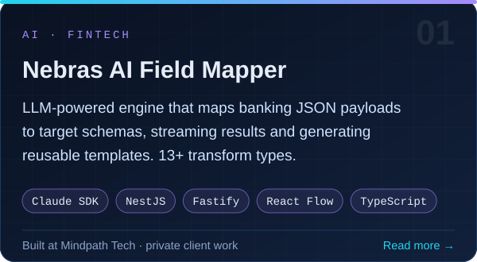
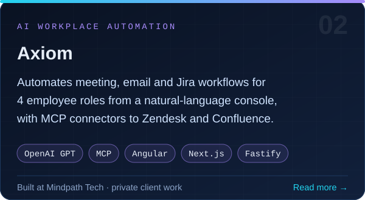
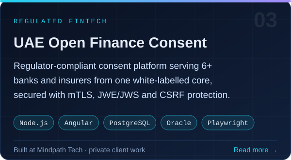
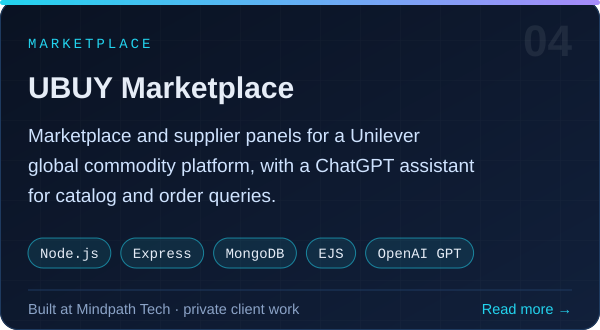

  &nbsp;
  &nbsp;
  

## 👋 About me

I'm a **Full Stack Developer at Mindpath Tech** (Indore, India) with **2.5+ years** of shipping web and mobile products on the **MERN and MEAN** stacks. Lately my work centres on **Generative AI**: putting LLMs into real client products.

- 🤖 Built an **AI field-mapping engine** on the **Anthropic Claude SDK** with streaming responses
- ⚙️ Developed **Axiom**, an AI workplace-automation platform on **OpenAI GPT** models
- 🔌 Implemented **Model Context Protocol (MCP)** connectors for Zendesk and Confluence
- 🏦 Delivered a **UAE Open Finance** consent platform for 6+ banks and insurers
- 📱 Shipped **React Native** apps for Android & iOS with Agora, Zoom and PhonePe
- 🎓 Pursuing an **M.Tech in Computer Science & Engineering**

## 🧭 Journey

## 🚀 Featured work

  
  

  
  

Client projects live in private repositories. Full write-ups are on my <a href="https://vikash-portfolio-omega.vercel.app/">portfolio</a>.

## 🧠 Generative AI toolkit

## 🛠️ Tech stack

  <b>Frontend</b>  
  

  <b>Backend, data &amp; mobile</b>  
  

  <b>DevOps &amp; testing</b>  
  

Also: React Native · Fastify · RxJS · NgRx · TypeORM · Oracle · WebSockets · Server-Sent Events · WebRTC · Agora · Zoom SDK · Playwright · SonarQube · PM2 · AWS Lambda

